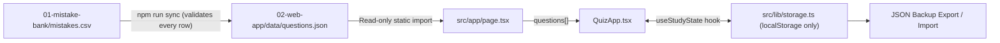

# Project Structure & Architecture

A local-first, single-user Japanese exam prep system for **JFT-Basic**, **JLPT N3**, **JLPT N2**, and **JLPT N1**.
All question content lives in one CSV spreadsheet; the Next.js app reads generated static JSON and saves your personal study progress in `localStorage`.

---

## 1. Workspace Structure

```text
JFT/
├── ROADMAP.md                      # Phase gates (0–4), Do-Not-Build & Stop/Pause rules
├── ARCHITECTURE.md                 # System structure & one-way data flow
├── 00-targets/
│   └── targets.md                  # Exam dates, baseline scores, weakest sections
├── 01-mistake-bank/
│   ├── README.md                   # Column rules (how to add a question)
│   └── mistakes.csv                # Master source of truth for all question content
├── 02-web-app/                     # Next.js 15 + TypeScript + Tailwind (Vercel-ready)
│   ├── CLAUDE.md                   # Concise app guide & constraints
│   ├── scripts/
│   │   ├── sync-mistakes.mjs       # CSV -> JSON, and VALIDATES every row (`npm run sync`)
│   │   └── sync-mistakes.test.mjs  # Parser & validator unit tests
│   ├── data/
│   │   └── questions.json          # Generated output — never edit by hand
│   └── src/
│       ├── types/
│       │   └── question.ts         # Question, ProgressMap, UserStudyState, AppView types
│       ├── lib/                    # Pure domain logic (tested, no React)
│       │   ├── quiz.ts             # Filtering, label stripping, answer matching, shuffle
│       │   ├── analytics.ts        # Streak, 7-day series, exam/section accuracy
│       │   └── storage.ts          # The ONLY file that touches localStorage + JSON backup
│       ├── hooks/
│       │   └── useStudyState.ts    # React state bridge over storage.ts + analytics.ts
│       ├── components/             # UI only, grouped by feature
│       │   ├── QuizApp.tsx         # Top-level view switcher (hub | bank | quiz | stats)
│       │   ├── layout/             # TopNav
│       │   ├── hub/                # LevelSwitcher, StudyHub, QuestionBankView
│       │   ├── quiz/               # QuizRunner (shuffled choices, Prev/Next, feedback)
│       │   ├── stats/              # StatsView, WeeklyAnalytics (Recharts)
│       │   └── ui/                 # Reusable primitives (Card, Badge, ProgressBar)
│       └── app/                    # Next.js App Router (layout.tsx, globals.css, page.tsx)
├── weekly-checks/
│   └── template.md                 # Copy weekly as 2026-W47.md, 2026-W48.md...
└── resources/                      # Sample test PDFs & textbook notes
```

---

## 2. One-Way Data Flow Architecture

```text
mistakes.csv  ──sync + validate──▶  questions.json  ──read-only──▶  Next.js app
 (content)        (npm run sync)      (generated)                        │
                                                                         ▼
                                                         localStorage (storage.ts only)
                                                               └─▶ JSON backup export
```



### Layer Boundaries
- **Content (`01-mistake-bank/mistakes.csv` → `npm run sync`):** `sync-mistakes.mjs` validates required columns, unique IDs, valid exam tags (`JFT`, `N3`, `N2`, `N1`, `N4`), valid sections (`vocabulary`, `grammar`, `reading`, `listening`), >= 2 choices, and valid answer mapping before writing `data/questions.json`.
- **Domain Logic (`src/lib/`):** Pure TypeScript modules (`quiz.ts`, `analytics.ts`, `storage.ts`) with zero React imports and unit tests (`npm test`). `storage.ts` is the **only** file allowed to read or write `localStorage`.
- **State Hook (`src/hooks/useStudyState.ts`):** Hydrates `localStorage` safely after mount and derives all KPI, streak, exam, and section snapshots.
- **UI Components (`src/components/`):** Grouped strictly by feature (`layout`, `hub`, `quiz`, `stats`, `ui`) with no direct `localStorage` calls.
